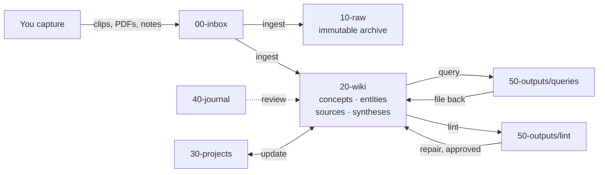

# Second Brain Template

A markdown vault that your AI agent (Claude Code, Codex, OpenCode, …) reads, writes, and maintains.
Sources go in, a linked wiki comes out, and every question you ask makes it better.

Built on Karpathy's [LLM Wiki](https://gist.github.com/karpathy/442a6bf555914893e9891c11519de94f) pattern,
with ideas from [super-brain](https://github.com/superhero-tech/super-brain) and others (see
[`90-system/prior-art.md`](90-system/prior-art.md)).

## Quick start

```bash
git clone <this-repo> my-brain && cd my-brain
claude        # or: codex / opencode
```

1. Say **"set up my profile"**. The agent interviews you and fills `90-system/about.md`.
2. Open the folder in [Obsidian](https://obsidian.md) as a vault (optional but recommended). Set the
   templates folder to `90-system/templates` and the attachment folder to `10-raw/assets`.
3. Drop something into `00-inbox/` and say **"ingest the inbox"**.

## How it works



| You | The agent |
|---|---|
| Capture anything into `00-inbox/` | Ingests: summarizes, cross-links, updates 5-15 pages per source |
| Write daily notes in `40-journal/` | Answers questions from the wiki with citations and gaps |
| Ask questions, make decisions | Keeps `index.md` and `log.md` current |
| Approve plans and fixes | Runs health checks and reports problems |

## Things to say

| Say | What happens |
|---|---|
| "ingest the inbox" / "ingest `<file>`" | Plan → your OK → archive to `10-raw/` → wiki pages + index + log |
| "what do I know about X?" | Answer from the wiki, cited, with a **Gaps** section; saved if substantial |
| "file that back" | Turns the last answer into a synthesis page |
| "check vault health" | Lint report in `50-outputs/lint/`, ranked, with no changes made |
| "fix lint items 1-3" | Repairs, one at a time, logged |
| "start project X" / "update project X" | Brief interview / log entry + index refresh |
| "weekly review" | Proposes what to promote from journal & inbox |

## Layout

```
00-inbox/      drop zone (you)
10-raw/        immutable sources (archived on ingest)
20-wiki/       compiled knowledge (agent)
30-projects/   brief.md + log.md per project
40-journal/    daily notes (you)
50-outputs/    saved answers & lint reports
90-system/     profile, templates, prior art
scripts/       lint.py: mechanical health check
.claude/       hook that protects 10-raw/ and 40-journal/
index.md       catalog: the agent reads it first
log.md         append-only timeline
AGENTS.md      the rulebook (CLAUDE.md imports it)
```

All rules live in [`AGENTS.md`](AGENTS.md). Change them there, and add discoveries to §7 *Learned conventions*.

## Guardrails

- **Linter**: `python3 scripts/lint.py` (add `--write` to save a report, `--json` for tooling). Checks broken
  links, frontmatter, index coverage, orphans, one-way links, duplicates, stale pages and inbox items, and
  in a git repo whether any file in `10-raw/` was modified. Exits 1 on errors, so it can run in CI or a pre-commit hook.
- **Protect hook** (Claude Code): `.claude/hooks/protect_paths.py` blocks the agent from editing, overwriting,
  deleting, or moving files in `10-raw/`, and from writing to `40-journal/`. Adding new sources still works.
  You can always edit those folders yourself.

## Tips

- **Ingest one source at a time** at first and read what changed. Batch ingest produces weaker links.
- **Commit after each operation.** `git diff` is your review tool.
- **Search** is just `index.md` + grep at first. Past a few hundred pages, add
  [qmd](https://github.com/tobi/qmd) for local hybrid search.
- Obsidian plugins that fit: Web Clipper (capture), Dataview (frontmatter queries), Marp (slides).
