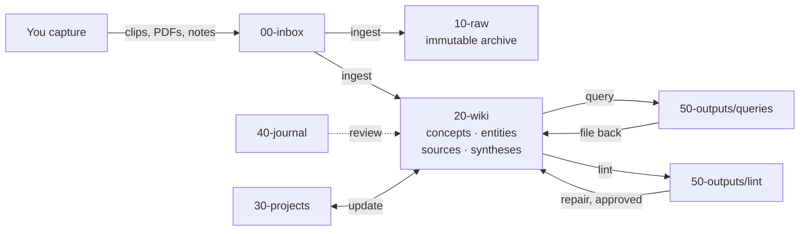

# Second Brain Template

A markdown vault that your AI agent (Claude Code, Codex, OpenCode, …) reads, writes, and maintains.
Sources go in, a linked wiki comes out, and every question you ask makes it better.

Built on Karpathy's [LLM Wiki](https://gist.github.com/karpathy/442a6bf555914893e9891c11519de94f) pattern,
with ideas from [super-brain](https://github.com/superhero-tech/super-brain) and others (see
[`90-system/prior-art.md`](90-system/prior-art.md)).

## Quick start

```bash
git clone <this-repo> my-brain && cd my-brain
claude        # or: codex / opencode
```

1. Say **"set up my profile"** (or `/setup`). The agent interviews you and fills `90-system/about.md`.
2. Open the folder in [Obsidian](https://obsidian.md) as a vault (optional but recommended). Set the
   templates folder to `90-system/templates` and the attachment folder to `10-raw/assets`.
3. Drop something into `00-inbox/` and say **"ingest the inbox"**.

## How it works



| You | The agent |
|---|---|
| Capture anything into `00-inbox/` | Ingests: summarizes, cross-links, updates 5-15 pages per source |
| Write daily notes in `40-journal/` | Answers questions from the wiki with citations and gaps |
| Ask questions, make decisions | Keeps `index.md` and `log.md` current |
| Approve plans and fixes | Runs health checks and reports problems |

## Things to say

Each flow is a skill in [`.agents/skills/`](.agents/skills/) (Codex, OpenCode), symlinked as `.claude/skills`
(Claude Code). Skills trigger from plain language, or you can call them directly, e.g. `/ingest`.

| Say | Skill | What happens |
|---|---|---|
| anything vague: "deal with my inbox", "what should I do?", `/second-brain` | `second-brain` | Router: picks and chains the flows below, or suggests next steps from vault state |
| "save this `<url>`" | `capture` | Verbatim copy into `00-inbox/` with metadata |
| "ingest the inbox" / "ingest `<file>`" | `ingest` | Plan → your OK → archive to `10-raw/` → wiki pages + index + log |
| "what do I know about X?" | `query` | Answer from the wiki, cited, with a **Gaps** section; saved if substantial; offers file-back |
| "check vault health" | `lint` | Linter + semantic review → ranked report in `50-outputs/lint/`, with no changes made |
| "fix lint items 1-3" | `repair` | Approved fixes, one at a time, re-linted and logged |
| "start / update / close project X" | `project` | Brief interview / log entry + index refresh / retrospective |
| "weekly review" | `brain-review` | Proposes what to promote from journal & inbox, open loops, focus |
| "set up my profile" | `setup` | Fills `90-system/about.md`, checks tools, guides the first ingest |

## Layout

```
00-inbox/      drop zone (you)
10-raw/        immutable sources (archived on ingest)
20-wiki/       compiled knowledge (agent)
30-projects/   brief.md + log.md per project
40-journal/    daily notes (you)
50-outputs/    saved answers & lint reports
90-system/     profile, templates, prior art
scripts/       lint.py (health check), qmd-sync.sh (search index)
.qmd/          qmd collection config (index itself is local)
.agents/skills/ the operation procedures (one SKILL.md per flow)
.claude/skills symlink -> ../.agents/skills (Claude Code)
index.md       catalog: the agent reads it first
log.md         append-only timeline
AGENTS.md      the rulebook (CLAUDE.md imports it)
```

All rules live in [`AGENTS.md`](AGENTS.md). Change them there, and add discoveries to §7 *Learned conventions*.

## Guardrails

- **Linter**: `python3 scripts/lint.py` (add `--write` to save a report, `--json` for tooling). Checks broken
  links, frontmatter, index coverage, orphans, one-way links, duplicates, stale pages and inbox items, and
  in a git repo whether any file in `10-raw/` was modified. Exits 1 on errors, so it can run in CI or a pre-commit hook.

## Search with qmd (optional)

Install [qmd](https://github.com/tobi/qmd) (`npm install -g @tobilu/qmd`), then once:

```bash
scripts/qmd-sync.sh --wait
```

This builds a local index for the `wiki`, `projects`, `journal` and `outputs` collections (`raw` is opt-in with
`-c raw`). The first run downloads the embedding model. After that the agent runs `scripts/qmd-sync.sh` at session
start and after every write flow: it re-indexes right away and embeds in the background. Without qmd, the
script does nothing and everything falls back to `index.md` + grep.

```bash
qmd search "zettelkasten" -n 5                       # keywords
qmd query $'intent: …\nvec: …' -n 10                # semantic
scripts/qmd-sync.sh --status                          # index health
```

## Tips

- **Ingest one source at a time** at first and read what changed. Batch ingest produces weaker links.
- **Commit after each operation.** `git diff` is your review tool.
- **Search**: `index.md` + grep works out of the box. If [qmd](https://github.com/tobi/qmd) is installed, the
  vault ships a project-local index config (`.qmd/index.yml`), and the agent keeps it fresh automatically (see below).
- Obsidian plugins that fit: Web Clipper (capture), Dataview (frontmatter queries), Marp (slides).
